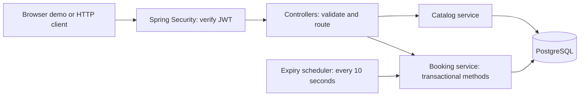
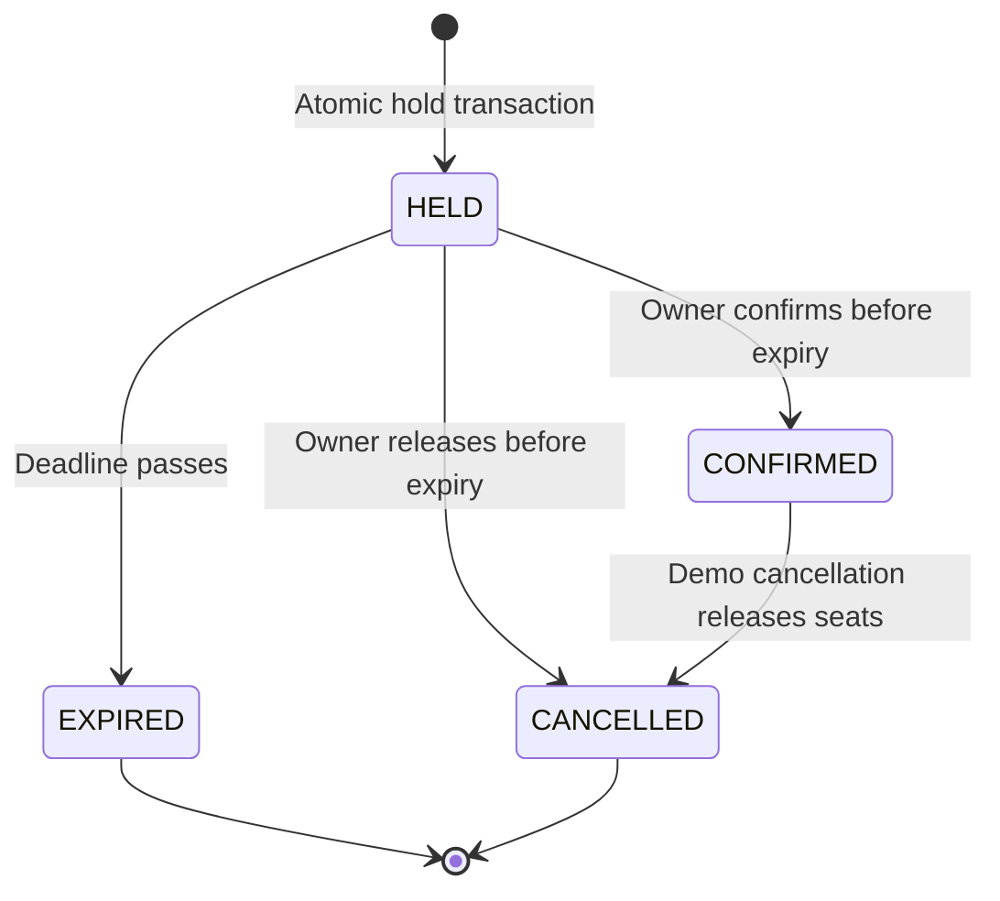

# Architecture and code walkthrough

## The problem and the boundary

Customers choose named seats for an event. A hold reserves a group of up to eight seats for at most 15 minutes. The customer can confirm or cancel; abandoned holds expire. If two customers race, only one may acquire an overlapping seat. A retry after a lost response must not create another booking.

One Spring Boot application owns these operations and one PostgreSQL database stores their authoritative state. The static browser application is served from the same origin. This keeps the consistency boundary inside one database transaction.



Public event browsing and registration/login are allowed without a token. Booking operations require a token. Event creation requires an administrator token. The booking service additionally checks that the verified user owns the booking; administrator status does not bypass ownership.

## Data model

| Table | Purpose | Important constraint |
|---|---|---|
| `app_user` | Identity, BCrypt password hash, role | Unique normalized email; role is USER or ADMIN |
| `event` | Event metadata, unit price, seat dimensions | Positive integer price, bounded layout |
| `booking` | Customer's hold/confirmation and idempotency record | Unique `(user_id, idempotency_key)` |
| `seat_inventory` | Current state of each physical seat | Primary key `(event_id, seat_code)`; one current `booking_id` |
| `booking_seat` | Immutable snapshot of seats selected by a booking | Primary key `(booking_id, seat_code)` |

An event has many inventory seats and bookings. A user has many bookings. A booking has many immutable `booking_seat` rows, while inventory points to its current owner. Composite foreign keys ensure that referenced bookings and seats belong to the same event.

Example after the first customer's hold expires and a second customer acquires A1:

```text
booking:
  old-id | customer-1 | EXPIRED (or HELD pending cleanup, expired by time)
  new-id | customer-2 | HELD, expiry in the future

booking_seat:
  old-id | event-1 | A1     <-- historical selection survives
  new-id | event-1 | A1

seat_inventory:
  event-1 | A1 | HELD | new-id | new-expiry
```

If history lived only in inventory, reassigning A1 would erase which seat the original customer selected. If history alone represented ownership, several historical rows could misleadingly appear to own the same seat. Keeping both makes the distinction explicit.

The inventory `CHECK` constraint permits exactly these shapes:

```text
AVAILABLE => booking_id NULL,     hold_until NULL
HELD      => booking_id NOT NULL, hold_until NOT NULL
BOOKED    => booking_id NOT NULL, hold_until NULL
```

These constraints catch malformed persisted states. They do not replace the locking protocol: without locking, two transactions could create two live booking records and overwrite the same inventory owner.

## Lifecycle



Inventory uses `BOOKED` where the booking uses `CONFIRMED`. Repeated confirmation of a confirmed booking and repeated cancellation of a cancelled booking return its current state. Confirming a cancelled booking returns `409 INVALID_STATE`. Confirming or cancelling an expired hold returns `410 HOLD_EXPIRED`. Make a new hold with a new key to try again.

## Trace `BookingService.hold`

`BookingController` obtains the user's UUID from the verified JWT, never from request JSON. Bean validation rejects an empty seat selection, more than eight seats, nulls and invalid code formats. The service then:

1. Validates the key's syntax and rejects duplicate seats.
2. Sorts the seat codes and hashes `eventId|sorted,seat,codes` with SHA-256. Sorting makes `A1,A2` equivalent to `A2,A1` for retry purposes.
3. Reads the event and computes the price from its unit price. Money is stored in integer paise, so no floating-point rounding is needed.
4. Attempts to insert the booking with `ON CONFLICT (user_id,idempotency_key) DO NOTHING`.
5. If the insert loses, it reads the existing booking, compares the fingerprint and either returns that booking or rejects a mismatched intent.
6. If the insert wins, it locks **all requested inventory rows in sorted order**.
7. Reads `clock_timestamp()` from PostgreSQL **after** those locks are acquired.
8. Checks that every requested seat exists, the event has not started, and each seat is available or has an expired hold.
9. Sets one expiry instant, inserts the historical selection and assigns all the seats to this booking.
10. Returns the booking view; Spring's transaction interceptor commits before the controller sends success.

Any exception rolls back the new booking, key claim, history and seat changes together. A rejected attempt does not leave a partial group reservation or consume its key.

The core SQL is visible in `BookingService.lockSeats`:

```sql
SELECT seat_code, status, booking_id, hold_until
FROM seat_inventory
WHERE event_id = :event AND seat_code IN (:codes)
ORDER BY seat_code
FOR UPDATE;
```

## Two customers, one seat

| Moment | Customer A's transaction | Customer B's transaction |
|---|---|---|
| 1 | Inserts booking A with key A | Inserts booking B with key B |
| 2 | Locks inventory A1 | Tries to lock A1 and waits |
| 3 | Sees A1 available; assigns it to A | Still waiting |
| 4 | Commits; row lock is released | Acquires the lock and sees A1 now held by A |
| 5 | Gets `201` | Throws `SEAT_UNAVAILABLE`; its booking/key insert rolls back; gets `409` |

The application uses PostgreSQL's default **READ COMMITTED** isolation. `SELECT FOR UPDATE` waits for a competing writer and then locks the updated row. Validation must happen against that locked state. A prior read or the browser's seat map is only advisory.

If A rolls back instead of committing, B can acquire the still-available seat. If A's response disappears after commit, A can retry the same key and recover booking A.

## Idempotency is durable coordination

The unique `(user_id, key)` index arbitrates simultaneous retries, including requests arriving at different application instances. There is no process-local map or check-then-insert window. A conflicting insert waits for the first transaction; after a commit it takes the replay path. After a rollback it can become the successful insert.

The key identifies a successful **hold intent**, not a new resource on every call. Keys are scoped to the authenticated user and retained with the booking. No cleanup of old keys is currently implemented.

Contract details:

- First successful hold: `201`, `Idempotency-Replayed: false`, and a `Location` header.
- Same successful user/key and canonical selection: `200`, `Idempotency-Replayed: true`, same booking ID.
- A replay returns the booking's **current** status. It does not promise identical response bytes after confirmation or expiry.
- A changed selection with the same already-successful key is a `409` mismatch.
- A failed hold rolls back its key claim. Retrying it is safe; changing that failed intent is also allowed.
- Naturally repeated confirm/cancel operations are handled by their state checks under the booking lock; they do not need a separate key.

## The 15-minute hold does not hold a database lock

The hold transaction commits quickly and releases its connection and locks. The reservation remains because the database rows contain `booking_id`, `status` and `hold_until`. Default expiry is database time plus 900 seconds, capped at event start.

`clock_timestamp()` represents actual time at the query. PostgreSQL's `now()` represents transaction-start time, which could be stale after waiting for a lock. Reading time after acquiring locks avoids confirming a hold that expired while the request waited.

Expiration has two layers:

1. **Immediate logical expiry.** Seat queries treat expired `HELD` inventory as available; booking views report expired held bookings as `EXPIRED`. A new hold can overwrite an expired inventory hold while owning that seat's row lock.
2. **Eventual cleanup.** Every 10 seconds, the scheduler finds up to 100 expired bookings and calls the proxied `expire` service once per booking. It persists `EXPIRED` and releases any seats still owned by that booking.

Correctness does not depend on the scheduler firing exactly at the deadline. The database expiry check governs acquisition and confirmation.

### The subtle stale-cleanup race

Suppose booking X expires. Booking Y reclaims X's A1 before the scheduler sees X. The later cleanup must not turn Y's A1 into AVAILABLE.

Cleanup locks X's booking, locks its historical seats, then performs:

```sql
UPDATE seat_inventory
SET status = 'AVAILABLE', booking_id = NULL, hold_until = NULL
WHERE booking_id = :oldBookingId;
```

A1 now references Y, so that update cannot release it. This owner condition is as important as checking the deadline. Confirmation also verifies that every selected seat still belongs to its booking before marking them booked.

## Lock ordering and transaction boundaries

- New holds claim their **new** booking/key, then lock their requested seats in sorted order. They do not lock or update the old bookings whose expired seats they reclaim.
- Confirm, cancel and expiry lock **their own booking first**, then that booking's historical seats in the same sorted order.
- Cleanup uses one transaction per booking, rather than holding one batch of unrelated booking locks while acquiring seat locks across the batch.
- All mutations use the same database, and no payment/network call runs inside these transactions.

This avoids lock cycles among these application paths. It does not justify disabling PostgreSQL deadlock detection or claiming every possible future SQL operation is deadlock-free. Lock and statement timeouts bound waits; transient database failures are mapped to `503` with a retry hint. Clients should retry a hold with the same key and use backoff.

`@Transactional` works because controllers and the separate scheduler bean call Spring-managed service proxies. A new method calling another transactional method on `this` would bypass proxy interception; do not introduce that pattern for per-booking cleanup.

## Security

`AuthService` normalizes email, stores BCrypt hashes and issues one-hour HS256 JWTs. The configured secret must contain at least 32 UTF-8 bytes. Tokens contain subject, role, issuer, audience, issued-at and expiry claims.

Spring Security verifies the signature, expected issuer, audience and token timestamps. The configured converter maps the role to a Spring authority. Registration cannot choose its own role. Invalid login attempts return the same generic response for unknown emails and incorrect passwords; a dummy hash avoids skipping the password check for unknown users.

Authentication answers “which user?” Authorization answers “may this user do this?” Owner-specific booking queries include `user_id`, returning `404` to other users. The backend derives price and identity itself and rejects unknown JSON fields such as a client-provided `totalPaise`.

The browser stores the token in memory. Reloading signs it out locally; the signed token remains valid until expiry. There is no refresh-token, logout revocation or external OAuth authorization server. CSRF is disabled because this API authenticates through explicit bearer headers and does not use cookies. That decision must be revisited if cookie authentication is added. A same-origin Content Security Policy and escaped DOM content reduce browser injection exposure.

## Queries, limits and operations

- Listing bookings uses one SQL round trip with a correlated selection array; it does not fetch seats in a separate application query per booking.
- Event and booking lists are capped at 100 entries; cursor pagination is an exercise, not implemented behavior.
- The expiry index is partial on `status = 'HELD'`; owner/history and current inventory-owner lookups have indexes.
- HikariCP has 32 connections. Virtual request threads reduce request-thread overhead; they do not increase database capacity.
- Public health reveals status only. No sensitive actuator endpoint is exposed anonymously.
- Flyway creates and versions the schema. Application restart preserves database reservations and idempotency records.
- Demo fixtures run only when opted in and do not recreate existing users/events on each startup. Seed dates are relative to the first run; an old database's demo events can eventually be in the past.

## Tradeoffs and next steps

| Choice | Benefit | Cost or next step |
|---|---|---|
| One application + PostgreSQL | Clear atomic consistency boundary; easy to run and explain | Database is a coordination bottleneck and availability dependency |
| Pessimistic seat locks | Predictable conflict handling for scarce seats | Hot seats serialize; waits/timeouts need monitoring |
| Explicit JDBC | Exact SQL and lock scope are reviewable | Manual mapping and vendor-specific SQL |
| Inventory + immutable selection | Fast current ownership and preserved history | Expiry appears in both booking and inventory and must be changed atomically |
| HMAC JWT | Small self-contained demo without an identity provider | Shared signing secret, no immediate revocation, rotation not implemented |
| Local polling | Simple live availability | Up to five seconds of stale display; server remains authoritative |
| Direct confirmation | Complete booking lifecycle without external accounts | No payment, refunds, admission QR or webhook workflow |

With real payments, add a separate payment attempt identity and gateway idempotency, verify webhooks, reconcile late/duplicate events, and define refunds when a hold has expired. Do not hold seat-row locks while waiting for a payment gateway. Use a transactional outbox for notifications when atomic database-plus-message delivery becomes necessary.

With multiple app instances sharing the database, the same SQL locking and unique constraints still coordinate requests, and sweeper calls serialize on booking rows. That is a design argument; the included measured load is a **single-instance** run. Prove multi-instance behavior separately before attaching numbers to it.

## Primary references

- [PostgreSQL explicit row locks and deadlocks](https://www.postgresql.org/docs/17/explicit-locking.html)
- [PostgreSQL date/time functions](https://www.postgresql.org/docs/17/functions-datetime.html)
- [PostgreSQL INSERT and ON CONFLICT](https://www.postgresql.org/docs/17/sql-insert.html)
- [Spring JDBC](https://docs.spring.io/spring-framework/reference/data-access/jdbc/core.html)
- [Spring transaction proxy behavior](https://docs.spring.io/spring-framework/reference/data-access/transaction/declarative/annotations.html)
- [Spring Security JWT resource server](https://docs.spring.io/spring-security/reference/servlet/oauth2/resource-server/jwt.html)
- [Spring Boot 3.5 system requirements](https://docs.spring.io/spring-boot/3.5/system-requirements.html)
